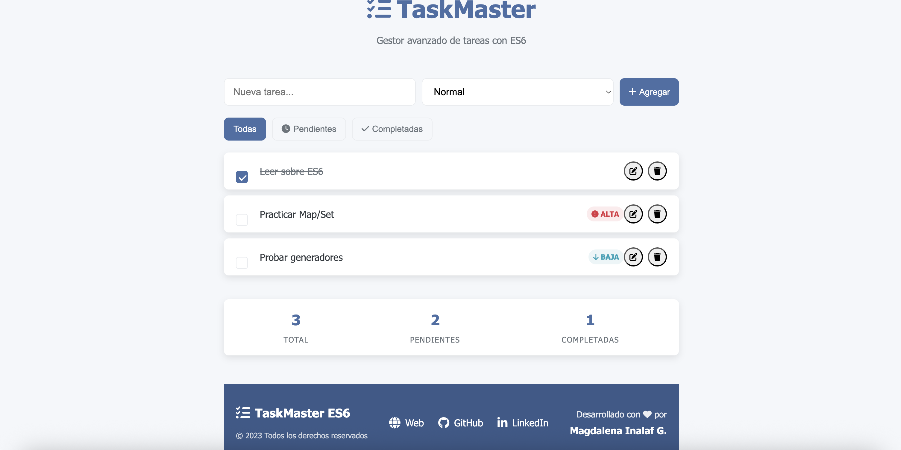
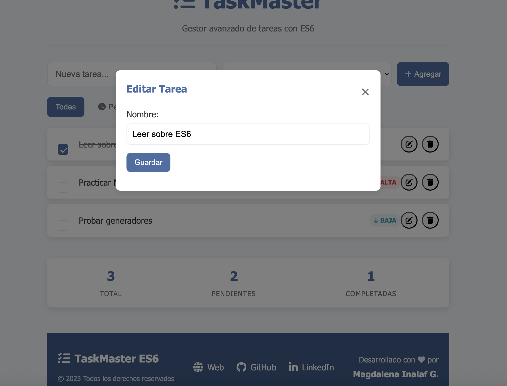

# TaskMaster ES6

**TaskMaster ES6** es una aplicación de gestión de tareas desarrollada con JavaScript ES6, enfocada en demostrar el uso de:
- Clases y herencia
- Módulos ES6
- Operadores Spread y Rest
- Async/Await
- Sets y Maps
- Interacción con el DOM
- Eventos personalizados
- Filtrado dinámico

La interfaz permite agregar, editar, eliminar, filtrar y marcar tareas como completas o pendientes, además de manejar prioridades.

## Características

- **Agregar tareas** con nombre y prioridad opcional.
- **Editar tareas** (nombre y prioridad).
- **Eliminar tareas** con confirmación.
- **Marcar como completadas o pendientes** desde un checkbox.
- **Filtrar tareas** (todas, pendientes, completadas).
- **Contadores dinámicos** (total, pendientes, completadas).
- **Persistencia temporal** en memoria (sin base de datos).
- **Interfaz responsiva** con modales y botones interactivos.
- **Pre-carga de datos** simulada con `async/await`.
- 
## Tecnologías usadas

- HTML5
- CSS3
- JavaScript ES6+
- [Font Awesome](https://fontawesome.com/) para iconos

## Estructura del proyecto

tareas-es6/

│
├── index.html

├── assets/

│   ├── css/

│   │   └── styles.css

│   └── js/

│       ├── classes.js

│       ├── store.js

│       └── main.js

└── README.md

## Instalación y uso

1. Clonar el repositorio:
  - Usa la opción de "Code" en GitHub y clona con HTTPS o SSH.
2. Abrir el proyecto en tu editor preferido.
3. Ejecutar un servidor local:
  - Puedes usar **Live Server** en VSCode/WebStorm.
4. Abrir `index.html` en el navegador.
5. Interactuar con la aplicación:
  - Agregar tareas, cambiar su estado, filtrarlas, editarlas o eliminarlas.
  - 
## Capturas de pantalla

## Autor

Desarrollado por **Magdalena Inalaf G.**
- [Sitio web](https://inalaf.ca)
- [GitHub](https://github.com/MagdaIG)
- [LinkedIn](https://www.linkedin.com/in/minalaf/)

## Licencia

Este proyecto se distribuye bajo la licencia MIT.

